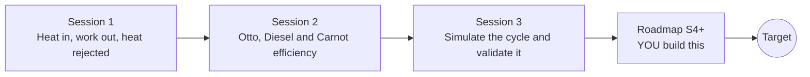

# openengine

[](https://github.com/KrunalPanchal1995/openengine/actions/workflows/ci.yml)   [](https://colab.research.google.com/github/KrunalPanchal1995/openengine/blob/main/sessions/session-01/lesson.ipynb) [](https://krunalpanchal1995.github.io/openengine/)

**Compare Otto and Diesel engines on P-V diagrams, in three sessions.**

openengine teaches how heat engines turn heat into work, from the energy balance to Otto, Diesel and Carnot cycles and a numerical engine simulation, using only Python and a browser.

- **Start from zero.** Session 1 needs only school arithmetic: heat in, work out, and the area of a rectangle.
- **See the loops.** Every session ships a slider app that runs in the browser, with labelled P-V and efficiency graphs.
- **Know you got it right.** Each session ends with a checkpoint that prints PASS or FAIL against hand calculations and the first law.
- **Build the missing half.** The repo stops at Session 3 on purpose; the roadmap shows the path to the Target.

[Target](#the-target) · [Who is this for](#who-is-this-for) · [Quick start](#quick-start) · [Sessions](#sessions) · [Roadmap](#roadmap) · [Contribute](#contribute) · [Explainer PDF](docs/explainer.pdf)

> **This repo is incomplete on purpose.** Sessions 1 to 3 are here and fully working. The finished Target below is a preview of what the community can build next. We show you the path, not the code. Sessions 4 and up are yours.

## The Target

Three ideal engines take the same heat per cycle and run side by side: an Otto engine (compression ratio 9), a Diesel engine (compression ratio 18) and a Carnot engine. Each shows a piston coloured by gas temperature, a P-V loop and a T-S loop traced live, and a running readout of work and efficiency that settles at 0.585, 0.624 and 0.867. Your goal over the coming sessions: build that animation yourself, including the T-S diagram and the Carnot loop, and see why the most efficient cycle on paper is not the one in your car.


*Target: Otto, Diesel and Carnot cycles side by side with live P-V and T-S loops*


*CFD project: hot-spot ignition. Temperature maps at 0, 4.8, 6.6 and 24 ms show a warm patch running away into a burning kernel, with the hottest-point temperature jumping at about 6.6 ms; the same kind of self-ignition that causes knock in Session 3*

Try it live:

- [Math Visual Studio: thermodynamic cycles (Atlas S55)](https://krunalpanchal1995.github.io/studio/#atlas?ch=S55&ex=1)
- [Math Visual Studio: the second law and entropy (Atlas S54)](https://krunalpanchal1995.github.io/studio/#atlas?ch=S54&ex=1)

How the Target was made is shown only as a path in [promo/roadmap.md](promo/roadmap.md).

## Who is this for
**higher secondary to diploma / undergraduate (levels 4-5).** Topic area: Heat, Thermodynamics and Fluid Mechanics.

Prerequisites:

- School arithmetic and powers (what 9 to the power 0.4 means); the idea of pressure and volume of a gas.
- Python 3.10 or newer; if `python --version` works, you are ready. PRIMER.md explains the rest.
- No prior GitHub, thermodynamics or calculus experience is needed; Session 3 explains the numerical steps it uses.

New to Python? Read [PRIMER.md](PRIMER.md) first (10 minutes).

## Quick start

No installation knowledge needed. You need [Git](https://git-scm.com/downloads) and [Python 3.10+](https://www.python.org/downloads/) (Windows: tick "Add Python to PATH"). On Mac and Linux type `python3` wherever this page says `python`.

```bash
git clone https://github.com/KrunalPanchal1995/openengine.git
cd openengine
python start.py 1
```

`start.py` creates a private environment, installs what is needed and runs Session 1 with its checkpoint. Next: `python start.py 2`, `python start.py 3`, or `python start.py test` to check everything. Only a checkpoint: `python start.py check 1`.

Four lines turn the idea of Session 2 into a result (they work as they are): Save it as `try.py` and run it with `python start.py run try.py` (this uses the private environment, where NumPy is installed):

```python
import numpy as np
r, gamma = 9.0, 1.4                       # compression ratio, gamma of air
print(np.round(1 - r ** (1 - gamma), 3))   # -> 0.585  ideal Otto efficiency
print(np.round(1 - 300 / 2000, 3))         # -> 0.85   Carnot limit, 300 K and 2000 K
```

Every session also opens in your browser with sliders (no install): [live apps](https://krunalpanchal1995.github.io/openengine/). Or use the Colab badge above for the notebook.

## Sessions

| # | Session | Model level | Time | Live app |
|---|---|---|---|---|
| 1 | [Heat in, work out, heat rejected](sessions/session-01/README.md) | Level 1: conceptual interactive model | 60 min | [open](https://krunalpanchal1995.github.io/openengine/session-01/) |
| 2 | [Otto, Diesel and Carnot efficiency](sessions/session-02/README.md) | Level 2: mathematical engineering model | 75 min | [open](https://krunalpanchal1995.github.io/openengine/session-02/) |
| 3 | [Simulate the cycle and validate it](sessions/session-03/README.md) | Level 3: simulation and validation | 90 min | [open](https://krunalpanchal1995.github.io/openengine/session-03/) |

Each session follows the same six steps: A real-world problem, B concept and theory, C visual explanation, D interactive simulation, E worked example and experiment, F assessment and design challenge. Each ends with `checkpoint.py`, which prints `PASS` or `FAIL` against reference numbers. Session 3 also contains the real-world mini-project: **Choose the compression ratio of a small generator engine**.

## Architecture



| Folder or file | What is inside |
|---|---|
| `sessions/` | three sessions: README (A-F), `lesson.py`, notebook, live app, exercises, activity sheet, checkpoint |
| `promo/` | the Target: media, live links, and the roadmap (path only) |
| `docs/` | `explainer.tex` and the built `explainer.pdf` |
| `tests/` | runs every lesson and checkpoint headless |
| `start.py` | one command to set up and run anything |
| `QUALITY.md`, `RUBRIC.md` | the quality checklist and the scoring rubric |
| `.github/` | CI, PDF build, Pages deploy, issue and PR templates |

## Roadmap

| Milestone | What you will build | Difficulty |
|---|---|---|
| Session 4: Temperature-dependent gas properties | The Otto cycle with cv(T) from a simple polynomial instead of a constant gamma. | intermediate |
| Session 5: The dual (Seiliger) cycle | A function that splits the heat and returns efficiency and a P-V path. | intermediate |
| Session 6: T-S diagram from the simulation | Compute entropy along the simulated cycle and draw the T-S loop with the Carnot rectangle. | intermediate |
| Session 7: A knock model with engine speed | An induction-time integral on the end-gas temperature history. | advanced |
| Session 8: Four strokes with a pumping loop | Add gas exchange to the crank-angle model with a throttled intake. | advanced |

Full detail with a checkpoint per milestone: [promo/roadmap.md](promo/roadmap.md).

## Contribute
New to GitHub? Read [CONTRIBUTING.md](CONTRIBUTING.md); it starts from zero. Pick an issue labelled `good first issue`. Translations into Hindi, Telugu, Tamil and Malayalam are welcome.

<details>
<summary>Development</summary>

```bash
python start.py test        # runs every lesson and checkpoint
```
Lessons use `# %%` cell markers so they open as notebooks in VS Code. See [QUALITY.md](QUALITY.md) for the standard every session meets.
</details>

## License
MIT. See [LICENSE](LICENSE). Media in `promo/media` is (c) Krunal Panchal, CC BY 4.0.

## Acknowledgments
Part of the [PAN IIT OSS](https://hellofoss.tech-iitb.org/projects) open-source teaching collection, modelled on the structure of [openspline](https://github.com/openspline/openspline). Built on ideas from the Math Visual Studio at https://krunalpanchal1995.github.io/studio/.
