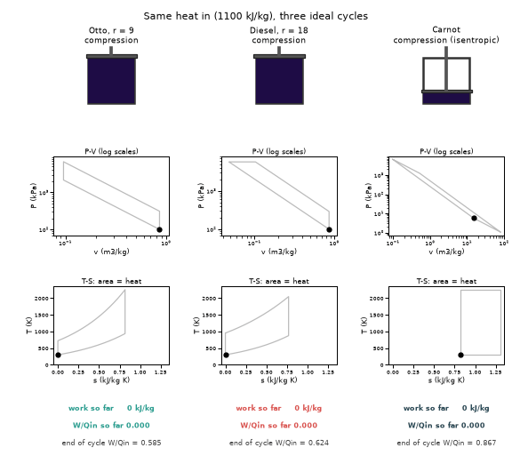
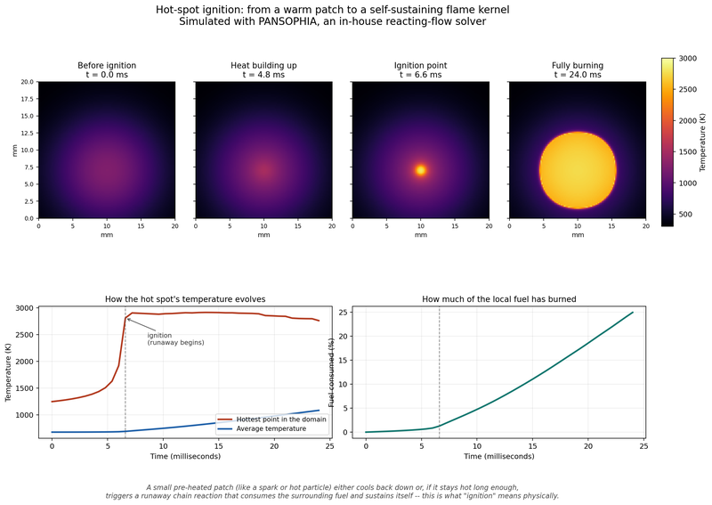

# What you are building toward

Three ideal engines take the same heat per cycle and run side by side: an Otto engine (compression ratio 9), a Diesel engine (compression ratio 18) and a Carnot engine. Each shows a piston coloured by gas temperature, a P-V loop and a T-S loop traced live, and a running readout of work and efficiency that settles at 0.585, 0.624 and 0.867. Your goal over the coming sessions: build that animation yourself, including the T-S diagram and the Carnot loop, and see why the most efficient cycle on paper is not the one in your car.

*Target: Otto, Diesel and Carnot cycles side by side with live P-V and T-S loops*

*CFD project: hot-spot ignition. Temperature maps at 0, 4.8, 6.6 and 24 ms show a warm patch running away into a burning kernel, with the hottest-point temperature jumping at about 6.6 ms; the same kind of self-ignition that causes knock in Session 3*

These results come from a private reference build. The code is not published; the roadmap shows the path so you can build your own.

Live links:

- [Math Visual Studio: thermodynamic cycles (Atlas S55)](https://krunalpanchal1995.github.io/studio/#atlas?ch=S55&ex=1)
- [Math Visual Studio: the second law and entropy (Atlas S54)](https://krunalpanchal1995.github.io/studio/#atlas?ch=S54&ex=1)
