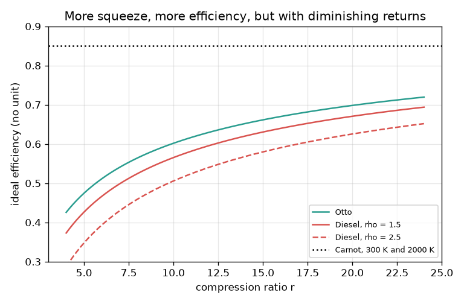
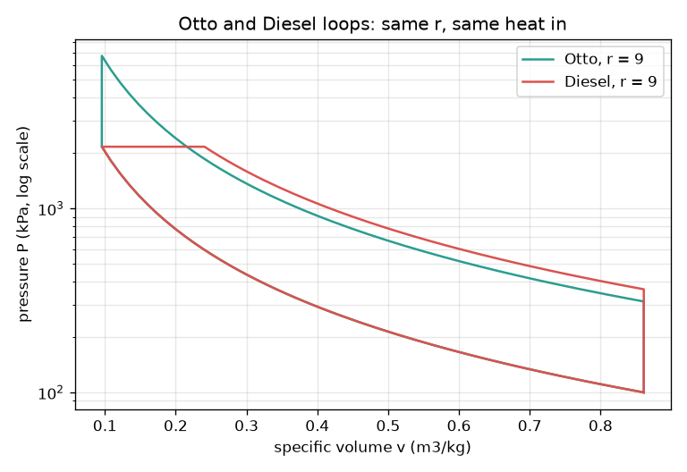

# Session 2: Otto, Diesel and Carnot efficiency

*Level 2 (mathematical engineering model) · about 75 minutes · openengine*

> This is a simplified educational model. It is not a validated design tool and must not be used for real structures, electrical installations, vehicles, industrial processes or medical decisions.

**Prerequisites**

- Session 1: energy balance, efficiency and the P-V loop.
- Powers such as 9 to the 0.4; ideal gas P V = R T is explained in Section B.

**Learning objectives.** After this session you can:

- Describe the four processes of the ideal Otto and Diesel cycles.
- Compute Otto, Diesel and Carnot efficiencies from r, rho, gamma and temperatures.
- Follow the temperatures round a cycle and recover the efficiency from the heats.
- Invert the formulas to choose r for a target efficiency, and explain why real engines do worse.

## A. Real-world problem
A petrol engine and a diesel engine both squeeze air, add heat and let the hot gas push a piston. What compression ratio do you need for an efficiency of 0.60, and why does a real engine, which is built to match such a cycle, reach much less? (Simplified air-standard model; not an engine design method.)

## B. Concept and theory
The air-standard model treats the working fluid as an ideal gas (P v = R T per kg) with constant gamma = cp / cv = 1.4, heated from outside and without friction or heat loss. The Otto cycle has four steps: isentropic compression 1 to 2 by the compression ratio r = V1 / V2, heat addition at constant volume 2 to 3, isentropic expansion 3 to 4, and heat rejection at constant volume 4 to 1. Along an isentrope T V^(gamma-1) and P V^gamma stay constant, which gives T2 = T1 r^(gamma-1) and the efficiency 1 - 1 / r^(gamma-1). The Diesel cycle adds heat at constant pressure, so the volume grows by the cut-off ratio rho = V3 / V2 during burning; its loss 1 - eta is the Otto loss times a factor that is above 1 for rho above 1, so at the same r its efficiency is lower. A larger r raises both, with diminishing returns. The Carnot limit 1 - Tc / Th uses the highest and lowest temperatures: Otto and Diesel add heat over a range of temperatures, not all at the peak, so they stay well below it. Real engines are lower again because of finite burn time, heat loss, friction, gas leakage and the change of gas properties with temperature; typically quoted brake efficiencies of petrol and diesel engines are roughly 25 to 40 percent (check a data sheet for a specific engine).

| Symbol | Meaning | Unit |
|---|---|---|
| r | compression ratio V1 / V2 | no unit |
| rho | cut-off ratio V3 / V2 (Diesel) | no unit |
| gamma | cp / cv of the gas, 1.4 for air | no unit |
| T1..T4 | gas temperature at states 1 to 4 | K |
| q_in, q_out | heat added, heat rejected | kJ/kg |
| R, cv | gas constant 0.287 and R / (gamma - 1) = 0.7175 | kJ/(kg K) |

**Assumptions**

- Air-standard: ideal gas, constant gamma = 1.4.
- Heat is added from outside; there is no combustion chemistry.
- Compression and expansion are isentropic (no heat, no friction).
- Temperatures in kelvin.

$$ T_2 = T_1\, r^{\gamma-1},\qquad P V^{\gamma} = \mathrm{const}\ \text{(isentrope)} $$

$$ \eta_{\mathrm{Otto}} = 1 - \frac{1}{r^{\gamma-1}} $$

$$ \eta_{\mathrm{Diesel}} = 1 - \frac{1}{r^{\gamma-1}}\,\frac{\rho^{\gamma}-1}{\gamma(\rho-1)} $$

$$ \eta_{\mathrm{Carnot}} = 1 - \frac{T_c}{T_h} $$

$$ r = (1-\eta)^{-1/(\gamma-1)}\quad\text{(Otto design)} $$

## C. Visual explanation
The first figure draws the Otto and Diesel loops for the same compression ratio and heat input on a log pressure axis: Otto has a vertical heat-addition line and a higher peak pressure, Diesel a horizontal one. The second figure plots ideal efficiency against r: all curves rise quickly at first and then flatten (going from r = 9 to 10 gains 0.017, from 19 to 20 only 0.006), the Diesel curves sit below Otto, and the Carnot line is far above all of them.

*Ideal efficiency against compression ratio for Otto, Diesel and the Carnot limit.*

*Otto and Diesel loops with the same r = 9 and heat input (log pressure axis).*

## D. Interactive simulation
Run the lesson (`python start.py 2`), then open the live app: [Session 2: Otto and Diesel loops](https://krunalpanchal1995.github.io/openengine/session-02/) (or `app.html` in this folder). Move r, rho and gamma. Watch the P-V loops change and read the efficiencies. Switch to the efficiency graph and see how much a bigger r buys and how rho lowers the Diesel curve.

**Challenge.** Find r, rho and gamma so that the Diesel cycle has efficiency of at least 0.60 with a cut-off ratio of at least 2.5.

## E. Worked example and experiment
**Problem.** An ideal Otto cycle with r = 9, gamma = 1.4, T1 = 300 K takes q_in = 1100 kJ/kg. Find the temperatures, the efficiency from the heats, and compare with the formula and the Carnot limit.

1. 9^0.4 = 2.408, so T2 = 300 x 2.408 = 722.5 K.
2. cv = 0.287 / 0.4 = 0.7175 kJ/(kg K). T3 = T2 + q_in / cv = 722.5 + 1100 / 0.7175 = 2255.6 K.
3. T4 = T3 / 2.408 = 936.6 K. Heat rejected q_out = cv (T4 - T1) = 0.7175 x 636.6 = 456.8 kJ/kg.
4. Efficiency from the heats = 1 - 456.8 / 1100 = 0.5848. Formula: 1 - 1 / 2.408 = 0.5847 (0.585). They agree.
5. Carnot between 300 K and 2255.6 K = 1 - 300 / 2255.6 = 0.867, much higher than 0.585, because heat is added from 722 K upward, not all at 2256 K.

**Answer.** T2 = 722.5 K, T3 = 2255.6 K, T4 = 936.6 K; efficiency 0.585 (Otto) against a Carnot limit of 0.867.

**Experiment.** Compare with a real engine: look up the brake thermal efficiency of a small petrol engine in a data sheet or measure fuel use and shaft power on a lab engine. It will be well below 0.585, for the reasons in Section B. The model is a ceiling that tells you which direction helps (higher r), not a prediction of the engine's number.

## F. Assessment and design challenge
**Question type A: Conceptual.** At the same compression ratio and the same heat input, which is more efficient, Otto or Diesel, and why?

Hint

Where in the piston stroke is the heat added in each cycle?

Step-by-step solution

Otto. Its heat is added at constant volume while the piston is at the top, so all of it is expanded through the full stroke. The Diesel adds part of its heat while the piston is already moving down, so that heat is expanded less. The factor (rho^gamma - 1) / (gamma (rho - 1)) is above 1, which lowers the Diesel efficiency.

**Question type B: Numerical.** Find the ideal Otto efficiency for r = 8 and gamma = 1.4, and for the Diesel at r = 18 with rho = 2. Show the working.

Hint

Use 8^0.4 and 18^0.4, and 2^1.4 = 2.639.

Step-by-step solution

Otto: 8^0.4 = 2.297, so eta = 1 - 1 / 2.297 = 0.565. Diesel: 18^0.4 = 3.178, so 1 / 3.178 = 0.3147; factor = (2.639 - 1) / (1.4 x 1) = 1.171; eta = 1 - 0.3148 x 1.171 = 0.632. Both are between 0 and 1 and below the Otto value at r = 18 (0.685), as expected.

**Question type C: Graph and simulation interpretation.** From the efficiency graph, is it worth raising r from 19 to 20? Compare with raising it from 9 to 10.

Hint

Read how steep each curve is at those r values.

Step-by-step solution

The curves flatten. From 9 to 10 the Otto efficiency gains 0.017; from 19 to 20 only 0.006, about a third as much, while the cost (peak pressure, knock, strength) rises. So the same extra squeeze buys much less at high r.

**Question type D: Design and optimisation challenge.** Design: choose r so that an ideal Otto engine reaches 0.60. A Diesel with r = 18 must also reach 0.60: what is the largest cut-off ratio allowed? Why will the real engines still be well below 0.60?

Hint

Invert: r = (1 - eta)^(-1/0.4); for the Diesel solve the formula for rho numerically.

Step-by-step solution

Otto: r = 0.4^(-2.5) = 9.88, about 10. Diesel at r = 18: the largest rho is 2.73 (above that eta drops below 0.60); in heat terms this limits how much fuel can burn at constant pressure. Real engines are lower because the burn takes time, heat leaks to the walls, friction takes work, and the gas properties change at high temperature (gamma falls); the model also ignores gas exchange. Constraint: higher r raises pressure, structural load and (for petrol) the risk of knock, treated in Session 3.

Score yourself with [RUBRIC.md](../../RUBRIC.md). Print the [activity sheet](activity_sheet.md) to work on paper.

## Common misconceptions
| Common misconception | What is actually true |
|---|---|
| Diesel engines are always more efficient than Otto engines on paper. | At equal compression ratio Otto is better; real diesels win because they can use a much higher r (Session 3). |
| Doubling the compression ratio doubles the efficiency. | Efficiency rises with diminishing returns: going from r = 10 to 20 raises the Otto efficiency only from 0.60 to 0.70. |
| The ideal cycle formula predicts the engine's actual efficiency. | It is an upper bound for the air-standard model; real engines are far lower. |
| Carnot efficiency applies to any engine with the same r. | Carnot depends only on the highest and lowest temperatures; Otto and Diesel add heat over a temperature range, so they stay below it. |

## Glossary
- **isentropic**: no heat flow and no friction; for an ideal gas P V^gamma stays constant
- **compression ratio**: largest volume divided by smallest volume, r = V1 / V2
- **cut-off ratio**: volume at the end of heat addition divided by the volume at its start (Diesel)
- **gamma**: ratio cp / cv of the gas, 1.4 for air
- **air-standard cycle**: a cycle analysed with air as an ideal gas and heat supplied from outside

## Finish
1. Do the three coding tasks in [exercises.md](exercises.md).
2. Run `python start.py 2` again after your changes. It ends with the checkpoint; when it prints `PASS`, you are done. (Checkpoint only: `python start.py check 2`.)

Next: [Session 3](../session-03/README.md)
