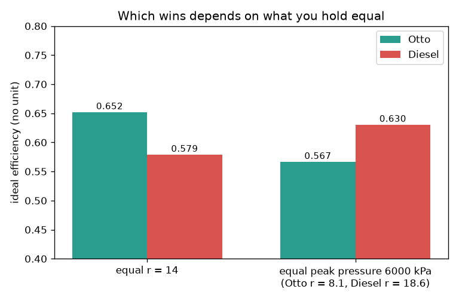
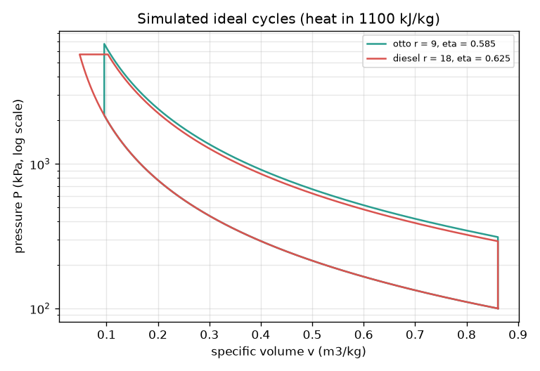
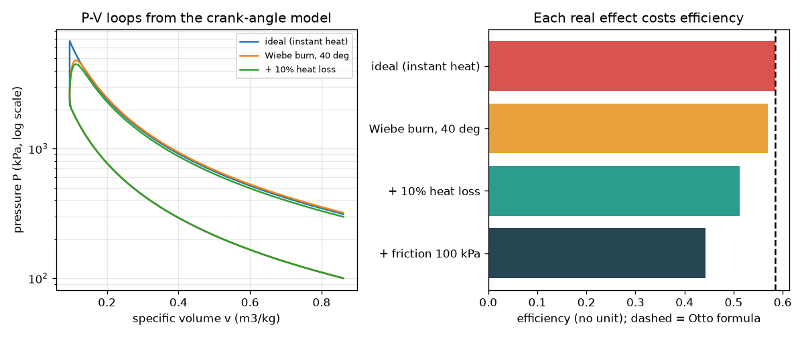

# Session 3: Simulate the cycle and validate it

*Level 3 (simulation and validation) · about 90 minutes · openengine*

> This is a simplified educational model. It is not a validated design tool and must not be used for real structures, electrical installations, vehicles, industrial processes or medical decisions.

**Prerequisites**

- Session 1: energy balance and P-V loops.
- Session 2: the Otto and Diesel formulas.
- Idea of numerical integration (adding up small pieces); explained in Section B.

**Learning objectives.** After this session you can:

- Step through an ideal cycle numerically and compute work as a sum of P dV.
- Validate the simulation against the formulas and the first law (net work = net heat).
- Add a Wiebe burn, heat loss and friction and measure how much each costs.
- Compare Otto and Diesel fairly (equal r, equal peak pressure) and explain the knock limit.

## A. Real-world problem
The formulas of Session 2 assume that heat arrives instantly and that nothing is lost. A real engine burns fuel over tens of crank degrees, loses heat to its walls and drags against friction. Can we simulate the cycle step by step, show that it reproduces the formulas when we switch the real effects off, measure how much each effect costs, and choose a compression ratio for a small generator engine? (A simplified teaching model, not a design tool.)

## B. Concept and theory
For a small step of a closed ideal gas the first law is dQ = dU + P dv with U = P v / (gamma - 1) per kg. This gives dP/dv = -gamma P / v with no heat (integrated with Runge-Kutta 4), dP = (gamma - 1) dQ / v at constant volume and dv = (gamma - 1) dQ / (gamma P) at constant pressure. The work is the sum of P dv around the closed loop (trapezoid rule), and the first law demands net work = q_in - q_out. A crank-angle model uses the slider-crank volume V(a) and releases heat along a Wiebe curve x = 1 - exp(-A z^(m+1)), z = (a - a0) / duration, with A = 6.908 and m = 2; the pressure obeys dP/da = ((gamma - 1) dQ/da - gamma P dV/da) / V. A share of the heat can be lost to the walls, and friction is subtracted as a friction mean effective pressure times the displacement. Two fair comparisons: at equal compression ratio and heat Otto wins, but at equal peak pressure (the structural limit) the Diesel can compress harder before burning and wins. Knock: in a spark-ignition engine the unburnt end gas, heated to about T1 r^(gamma-1), can ignite by itself, causing a damaging pressure shock; this sets an upper limit on r for a given fuel. A diesel compresses only air and injects fuel at the end, so it avoids this particular limit.

| Symbol | Meaning | Unit |
|---|---|---|
| v, P | specific volume and pressure of the gas | m3/kg, kPa |
| q_in | heat added per kg of air | kJ/kg |
| a | crank angle from top dead centre | degrees |
| loss | share of heat lost to the walls | no unit |
| fmep | friction mean effective pressure | kPa |
| T2 | end-of-compression air temperature | K |

**Assumptions**

- Ideal gas with constant gamma = 1.4 and 1 kg of air per cycle.
- Heat loss is a fixed share of the heat, friction a fixed pressure (illustrative values).
- Exhaust and intake are replaced by constant-volume rejection at the bottom.
- The knock limit is an illustrative temperature, not a real fuel property.

$$ dQ = dU + P\,dv,\quad U = \frac{P v}{\gamma-1} $$

$$ \frac{dP}{dv} = -\gamma\frac{P}{v}\ \text{(no heat)} $$

$$ \frac{dP}{da} = \frac{(\gamma-1)\,dQ/da - \gamma P\,dV/da}{V} $$

$$ x_b(a) = 1 - \exp\!\left[-A\left(\frac{a-a_0}{\Delta a}\right)^{m+1}\right] $$

$$ W = \oint P\,dv \approx \sum \tfrac12 (P_i + P_{i+1})(v_{i+1} - v_i),\qquad W = q_{\mathrm{in}} - q_{\mathrm{out}} $$

## C. Visual explanation
Figure 1 shows the simulated ideal Otto (r = 9) and Diesel (r = 18) loops. Figure 2 shows the knock-down of the Otto engine: instant heat 0.584, a 40 degree Wiebe burn 0.570, plus 10 percent heat loss 0.513 and plus friction of 100 kPa a brake efficiency of 0.443, against the formula 0.585. Figure 3 compares the cycles: at equal r = 14 Otto gives 0.652 and Diesel 0.579; at equal peak pressure of 6000 kPa Otto must stay at r = 8.1 (0.567) while Diesel can use r = 18.6 (0.63).

*Otto beats Diesel at equal compression ratio; Diesel beats Otto at equal peak pressure.*

*Simulated ideal Otto (r = 9) and Diesel (r = 18) loops with the same heat input.*

*Left: P-V loops from the crank-angle model. Right: efficiency after each real effect.*

## D. Interactive simulation
Run the lesson (`python start.py 3`), then open the live app: [Session 3: a crank-angle engine simulation](https://krunalpanchal1995.github.io/openengine/session-03/) (or `app.html` in this folder). Move the crank angle to watch the piston, the gas colour and the pressure. Open the P-V view to compare the simulated loop with the ideal one. Then change r, the burn start, the burn duration and the heat loss, and read the efficiency graph.

**Challenge.** Make the engine knock-safe for fuel A (T2 at most 720 K) with a short burn (at most 25 degrees) that starts between 20 and 5 degrees before top dead centre.

## E. Worked example and experiment
**Problem.** Simulate the ideal Otto cycle with r = 9 and q_in = 1100 kJ/kg (P1 = 100 kPa, T1 = 300 K). Compare its efficiency with the formula and check the first law.

1. Compression: integrate dP/dv = -gamma P / v from v1 = 0.861 to v2 = 0.0957 m3/kg in 400 steps.
2. Heat at constant volume: add 1100 kJ/kg in 400 equal steps, dP = 0.4 dQ / v2; then expand back to v1 and cool to P1 at constant volume.
3. Sum P dv around the loop: net work = 643.3 kJ/kg; heat rejected = v1 (P4 - P1) / 0.4 = 456.8 kJ/kg.
4. Efficiency = 643.3 / 1100 = 0.58477; the formula gives 0.58476.
5. First law: net work - (q_in - q_out) = 0.02 kJ/kg, about 0.002 percent of the heat input.

**Answer.** Simulated efficiency 0.5848 (formula 0.5848), net work 643 kJ/kg, rejected heat 457 kJ/kg, first-law error 0.02 kJ/kg.

**Experiment.** If you have access to a lab engine with a pressure sensor, record a P-V loop and integrate its area. Its indicated efficiency will lie below the ideal value by the amounts the knock-down figure shows; the model differs from reality because of burn time, heat loss, changing gas properties, leakage and gas exchange, and the measured brake value is lower again by friction.

## Real-world application and mini-project: Choose the compression ratio of a small generator engine
A small generator engine can run on fuel A or fuel B. For illustration, fuel A tolerates an end-of-compression air temperature T2 of 740 K before it knocks and fuel B tolerates 800 K; the designer keeps a margin of 20 K. Use `max_r_knock_free` and `engine_cycle` from Session 3 (heat 1100 kJ/kg of air, Wiebe burn of 40 degrees from -10, 10 percent heat loss, friction mean effective pressure 100 kPa). The owner wants a brake efficiency of at least 0.45. These limits are illustrative numbers, not fuel specifications.

**Deliverable:** A script that prints, for each fuel, the largest knock-free compression ratio (steps of 0.5), its T2 and its modelled brake efficiency, says which fuel meets the 0.45 target, and saves a figure of brake efficiency against r with the two knock limits marked.

**Success looks like:** Fuel A gives r = 8.5 and brake efficiency 0.436 (misses the target); fuel B gives r = 10.5 and 0.463 (meets it); the report explains that the smallest r that reaches 0.45 is 9.5, which needs T2 = 738 K.

## F. Assessment and design challenge
**Question type A: Conceptual.** Why does a Diesel win at equal peak pressure although an Otto wins at equal compression ratio?

Hint

What limits each engine: the compression ratio or the peak pressure?

Step-by-step solution

At equal r the comparison favours the Otto because all its heat is added at top dead centre. But strength limits the peak pressure, not r. The Otto's peak pressure comes after heat addition at constant volume, so it must keep r low (8.1 for 6000 kPa); the Diesel's peak pressure is the end of compression, so it can use r = 18.6 and the higher r wins (0.63 against 0.57).

**Question type B: Numerical.** Find the end-of-compression temperature for r = 10 and r = 9 (T1 = 300 K, gamma = 1.4). A fuel allows T2 up to 740 K with a 20 K margin: is r = 10 acceptable?

Hint

T2 = T1 r^0.4; margin means T2 must not exceed 720 K.

Step-by-step solution

r = 10: 10^0.4 = 2.512, so T2 = 300 x 2.512 = 754 K. r = 9: 9^0.4 = 2.408, so T2 = 722 K. The allowed value is 740 - 20 = 720 K, so r = 10 is not acceptable and even r = 9 (722 K) is just too hot; the largest allowed r in steps of 0.5 is 8.5 (T2 = 706 K).

**Question type C: Graph and simulation interpretation.** In the knock-down figure, which single real effect costs the most efficiency, and by how much? Compare the burn time, the heat loss and the friction.

Hint

Take differences between the neighbouring bars: 0.584, 0.570, 0.513, 0.443.

Step-by-step solution

Burn time costs 0.584 - 0.570 = 0.014, 10 percent heat loss costs 0.570 - 0.513 = 0.057 and friction of 100 kPa costs 0.513 - 0.443 = 0.070. Friction costs the most in this setting, then heat loss; the finite burn is the smallest. (The numbers depend on the illustrative values.)

**Question type D: Design and optimisation challenge.** Design: a generator engine uses fuel A (T2 limit 740 K) with a 20 K margin, or fuel B (800 K). Choose r for each in steps of 0.5, find the modelled brake efficiency (10 percent loss, friction 100 kPa) and say which fuel meets a 0.45 target. What r would be needed?

Hint

Use max_r_knock_free and engine_cycle.

Step-by-step solution

Fuel A: r = 8.5 (T2 = 706 K), brake 0.436: misses the target. Fuel B: r = 10.5 (T2 = 768 K), brake 0.463: meets it. The smallest r that reaches 0.45 is 9.5 (T2 = 738 K), which fuel A cannot allow with its margin. Trade-off: a better fuel (or a lower friction or loss) is needed for the target; raising r above the knock limit would risk damage. All limits are illustrative.

Score yourself with [RUBRIC.md](../../RUBRIC.md). Print the [activity sheet](activity_sheet.md) to work on paper.

## Common misconceptions
| Common misconception | What is actually true |
|---|---|
| A simulation is right because it looks right. | It must be validated: here against the formulas in the limit with no real effects, and by the first law (net work = net heat). |
| The best cycle is the same whatever you hold equal. | Otto wins at equal compression ratio, Diesel at equal peak pressure; always state what is held equal. |
| Knock is just a noise. | It is a pressure shock from the unburnt gas igniting by itself and can damage the piston. |
| Friction and heat loss do not depend on r. | Here they are fixed illustrative values; in a real engine they change with r, speed and load, which is one road to the Target. |

## Glossary
- **Wiebe function**: a smooth S-shaped curve for the fraction of fuel burnt against crank angle
- **indicated efficiency**: efficiency from the gas P-V loop, before friction
- **brake efficiency**: efficiency after friction, from the shaft work
- **fmep**: friction mean effective pressure: friction work per displacement
- **knock**: self-ignition of the unburnt end gas that causes a damaging pressure shock

## Finish
1. Do the three coding tasks in [exercises.md](exercises.md).
2. Run `python start.py 3` again after your changes. It ends with the checkpoint; when it prints `PASS`, you are done. (Checkpoint only: `python start.py check 3`.)

Next: the [roadmap](../../promo/roadmap.md). Session 4 is yours to build.
